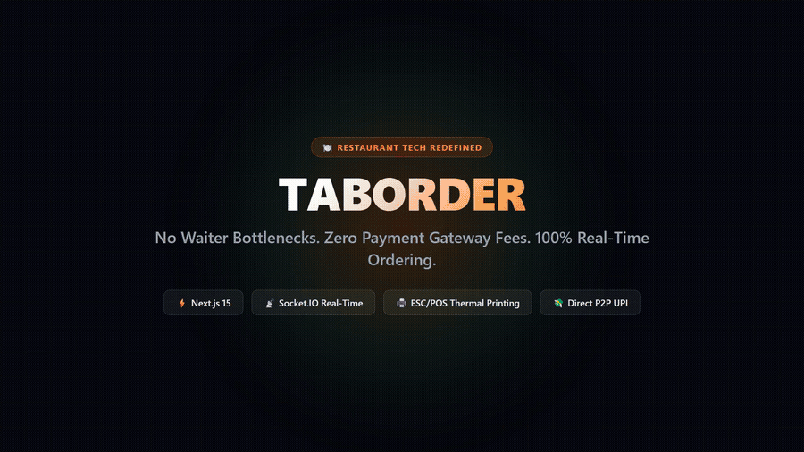
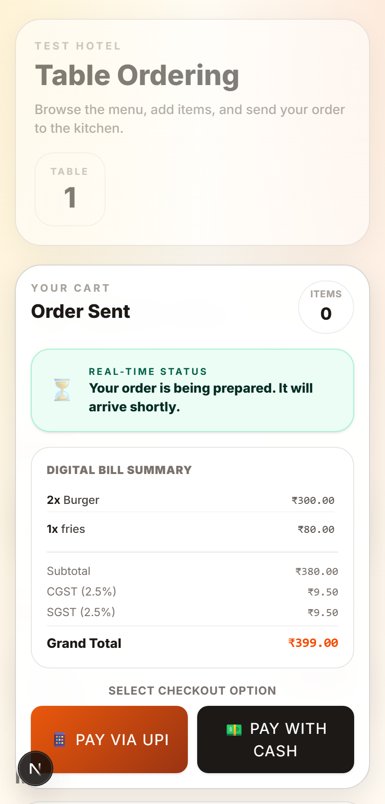
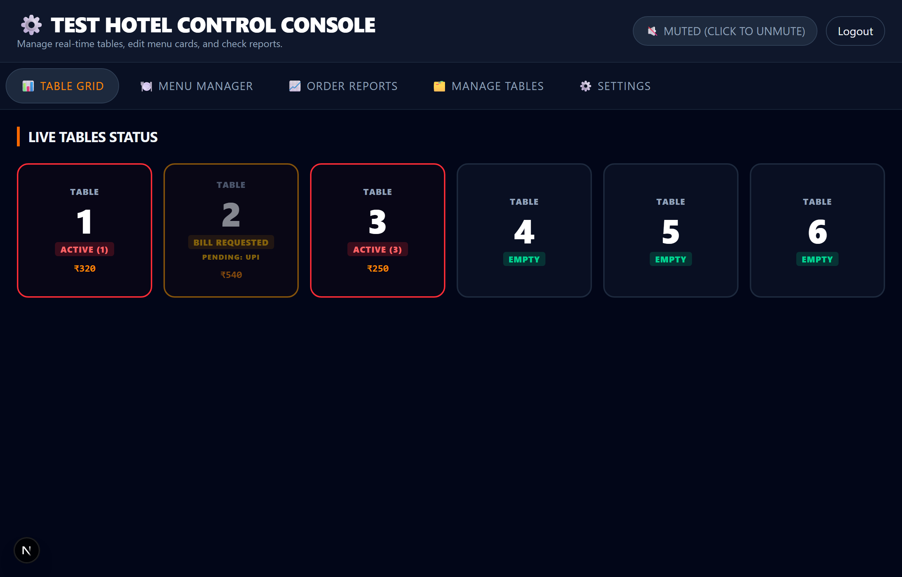
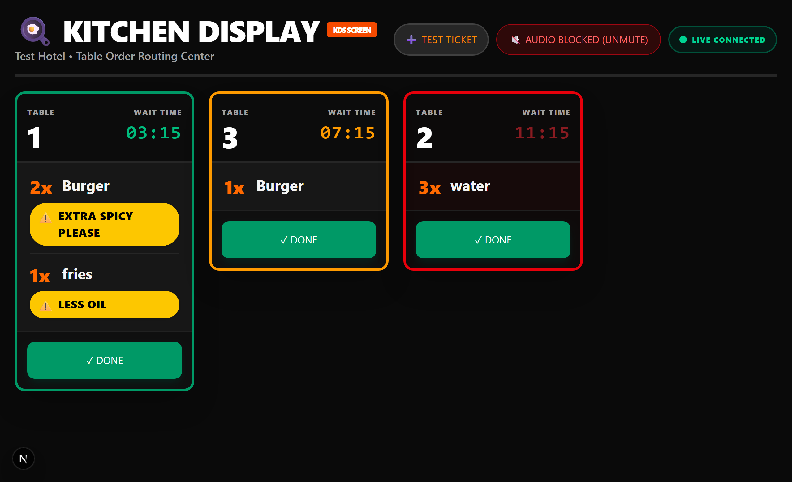

# 🍽️ TabOrder - Next-Gen Restaurant Table Ordering System


TabOrder is a complete, full-stack digital ordering ecosystem designed for modern restaurants. It eliminates waiter bottlenecks by allowing customers to order directly from their smartphones via table-specific QR codes, featuring zero-fee P2P UPI payments, a real-time Kitchen Display System (KDS), and hardware thermal printer integration.

## ✨ Key Features

* **📱 Customer QR Ordering:** Frictionless, app-free ordering experience locked to specific table sessions.
* **💸 Zero-Fee P2P UPI Checkout:** Dynamic UPI deep-link QR generation mapped directly to the merchant's VPA, bypassing payment gateway fees.
* **👨🍳 Real-Time Kitchen Display System (KDS):** Live WebSocket-powered kitchen dashboard with color-coded wait timers and audio chimes for new tickets.
* **🖨️ Hardware Thermal Printing:** Raw ESC/POS integration (`node-thermal-printer`) for automated kitchen tickets and customer bills.
* **⚙️ Admin Dashboard:** Complete control center for table management, dynamic menu CRUD operations, and live order tracking.
* **🔒 Session Security:** Table locking mechanisms to prevent cross-table order spamming.

## 🎬 Product Showcase Video



> 🎥 *Full launch video with audio is available in [`docs/taborder-launch.mp4`](docs/taborder-launch.mp4).*

## 📸 System Previews

| Customer Ordering UI | Admin Dashboard | KDS (Kitchen Display) |
| :---: | :---: | :---: |
|  |  |  |

## 🛠️ Tech Stack

**Frontend:**
* Next.js 15 (React 19)
* Tailwind CSS v4
* Socket.IO Client
* qrcode.react

**Backend:**
* Node.js & Express
* Socket.IO (WebSocket Engine)
* Prisma ORM
* PostgreSQL
* node-thermal-printer

## 🚀 Local Installation & Setup

### 1. Backend Setup
```bash
cd backend
npm install

# Set up your environment variables
cp .env.example .env

# Push the database schema
npx prisma db push

# Start the development server (runs on port 4000)
npm run dev
```

### 2. Frontend Setup

```bash
cd frontend
npm install

# Set up environment variables
echo "NEXT_PUBLIC_API_URL=http://localhost:4000" > .env.local

# Start the Next.js client (runs on port 3000)
npm run dev
```

## 🌐 Network Testing (Mobile Devices)

To test the customer UI on your physical phone:

1. Ensure both devices are on the same Wi-Fi or USB tether network.
2. Bind the Next.js server to `0.0.0.0` (configured in `package.json`).
3. Update `NEXT_PUBLIC_API_URL` to your laptop's local IPv4 address.
4. Access `http://<YOUR_LAPTOP_IP>:3000/?table=1` from your mobile browser.

## 🖨️ Printer Configuration

Thermal printing requires an ESC/POS compatible printer (USB or LAN). Configure your `.env` file:

```env
PRINTER_ENABLED=true
PRINTER_TYPE=epson
PRINTER_INTERFACE=tcp://192.168.1.50 # Or USB path
```

*(If `PRINTER_ENABLED=false`, the system gracefully falls back to a terminal console dry-run).*

## 👨💻 Author

**Rohith Papana**

* Electronics & Communication Engineering
* Embedded Systems & Full-Stack Developer
